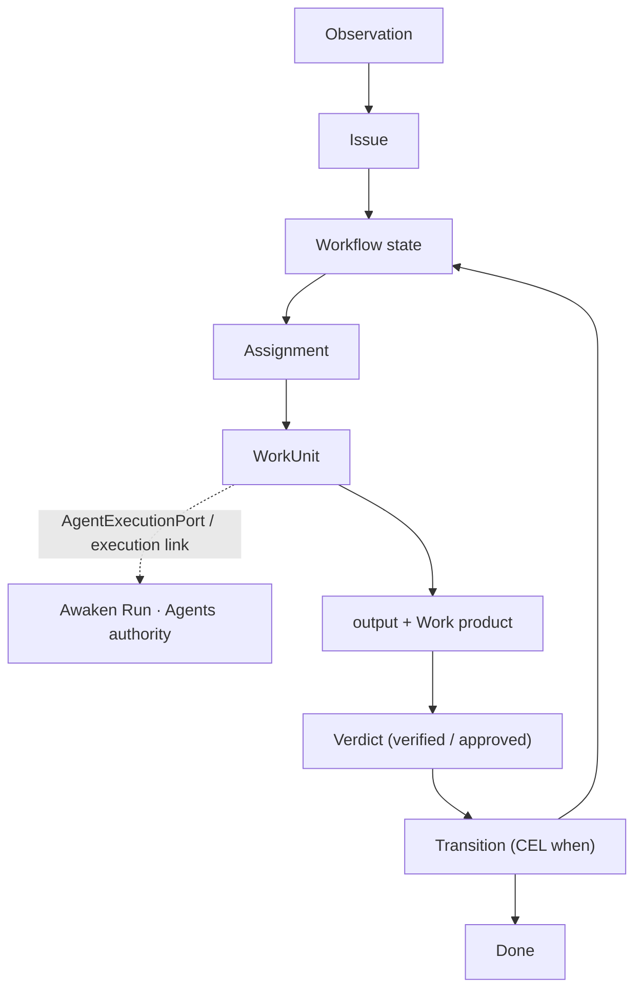

Awaken Workforce's kernel is **domain-neutral**: it knows a small set of primitives and
nothing about "marketing", "customer", or "coder". Domain meaning is added by
[domain packs](/docs/workforce/concepts/domain-packs). Understanding the few core
objects — and how they connect — is the key to everything else. If you haven't
read [Types as operational contracts](/docs/objects/concepts/type-system) yet, read it
first: this page is that model made concrete.

## Committed state, history, and live checks

Domain owners preserve their current state and the committed facts needed to
explain it. A history record and a projection do not replace that state:

- **Current state** includes an Issue's Workflow position and a WorkUnit's
  business execution status. The owning domain validates and persists changes.
- **History** records committed transitions and execution observations. Workforce
  consumes Awaken lifecycle facts through its existing inbox and execution link.
- **Projection** derives a read model from committed state and history. It does
  not become another owner of the underlying work or execution.
- **Live checks** verify current lease, credential availability and permission at
  the relevant execution boundary. An old observation is not current authority.

[Types as operational contracts](/docs/objects/concepts/type-system#where-types-carry-authority)
lists the types and checks that the current contracts validate.

## Kernel objects

Each object retains its domain owner. The [core-object guide](/docs/workforce/concepts/core-concepts)
owns the full work model; this overview connects that work to governed Resources.

- **Actor** — an identity that can raise issues, react, or perform work (a User, Agent,
  or Team).
- **Resource** — a governed thing that issues are raised against (a repo, a
  connector, a work product, a script, a credential kind — one catalog, facet-typed).
- **Issue** — a durable, visible unit of work against a resource; the primary
  process-backed **Subject**.
- **Reaction** — the system's declared response to an issue; the automation spine.
- **WorkUnit** — one Workforce business execution responsibility; an Agent-backed
  WorkUnit links to an Awaken Run rather than owning another Agent worker kernel.

Identity, authorization, admission, readiness, selection, approval and live
execution checks answer different questions. Their boundaries are described in
[Authorization, readiness, and Resources](/docs/objects/concepts/permissions-resources).

### Typed structure inside the process layer

Workflows and their parts are **not** top-level primitives — they are the typed
structure *inside* the Issue/process layer that gives a Subject its lifecycle:

- **Workflow** — a first-class Work-owned definition published as an immutable
  `WorkflowRevision`; its internal `ProcessSpec` specification contains states,
  transitions, slots, typed hand-off, and bounded iteration. Project selection
  resolves an exact revision, and each new Issue pins that `WorkflowRevisionRef`.
- **State** (`ProcessState`) — one phase, with slots, declared output exports and
  required inputs, optional fan-in, and a WIP limit.
- **Transition** — one guarded edge between states; a CEL `when` predicate decides
  if it fires (first match wins).
- **Agent** — an Agent Actor plus an editable `AgentDef` (`role_prompt` and optional
  model handle); the executor is a *facet* of a WorkUnit, not a separate root.
- **Tool** — a callable capability, invocation-gated by approval.

### Resources are typed objects with operations (the thing model)

The **Resource** root is where "an agent perceives an object-oriented world" becomes
concrete. A `ResourceType` is declared as a **thing model** — a typed shape plus the
operations that act on it:

- **Properties** — typed attributes: declared state, immutable-once or projected
  state, a static value, a **computed getter**, or durable **Content** represented
  by a closed descriptor while immutable bytes remain behind the content store.
- **Actions** — arg-taking methods on the object.
- **Events** — what the object can emit (each with an ingress-normalization script);
  these are the emission points for [reactions](/docs/workforce/concepts/reactions).
- **Lifecycle** — host-only hooks (`verify`, `resolve`, `health`) the platform runs,
  never the agent.

There is **one catalog and one noun, `Resource`**; a type is distinguished by its
**facets, not by subclassing**, and declares exactly one governance kind:
`object`, `configuration`, `credential`, or `connector`. Actions are dispatched
by name against a typed instance. Cross-object forwarding is declared through a
typed requirement role and `via: role.action`; Agents receive only explicitly
granted reads, mutations, and exact Actions—there is no ambient generic invoke
tool. Every operation runs in a governed, sandboxed, lease-checked boundary (see
[Develop a domain pack](/docs/workforce/designing/develop-a-domain-pack)). So an
agent operates on **typed domain objects with exact Actions and computed
properties** rather than a flat bag of tools.

> **What ships.** The governed object model—types, exact Actions, dispatch,
> computed properties, and durable Content—is available through the owning API,
> Workflow, observation, and realization paths. The scope-console MCP endpoint
> exposes five fixed operations: `resource.types`, `resource.query`,
> `resource.get`, `resource.realize`, and `resource.changes`. An Agent interaction
> derives a narrower tool list from its exact grant and may add relations,
> content read, terminal submission, or exact Action tools. It never receives an
> ambient object-operation capability.

### The scope tree

Every object roots in an ownership tree: **Org ⊃ Workspace ⊃ Project**. An **Org** is
the tenant boundary; a **Workspace** groups work inside it; a **Project** is the
innermost container an object belongs to. A single-node deployment seeds a singleton
Org, so the local and hosted shapes are one model.

## Work and execution ownership

- **Assignment** identifies the responsibility slot for an Issue's Workflow state.
- **WorkUnit** owns the corresponding business attempt, its status and accepted outputs.
- **Awaken Run** owns Agent execution, placement, await/resume and terminal execution facts.
  An Agent-backed WorkUnit starts or reconnects it through `AgentExecutionPort` and
  retains one exact execution link.
- **Workflow and Issue** decide how accepted outputs advance the work and what
  obligations must be satisfied before completion. Run success alone is not business acceptance.

[Agents, WorkUnits, and Awaken Runs](/docs/workforce/concepts/agents-runs) owns the
execution sequence, recovery and current integration status. The [core-object
guide](/docs/workforce/concepts/core-concepts) owns planning and human-obligation objects.

## Identity & assignment objects

Who can be assigned and who can act:

- **Workspace actor** — the common assignment identity over a **User**, **Agent**,
  or **Team**. Slots resolve to workspace actors.
- **Team** — a participation/selection grouping. A slot currently selects a concrete
  Actor or resolves through a Team; authorization remains separate.
- **Principal** — the typed identity authorization checks (`User`, `Agent`,
  `Team`, `ApiToken`, `System`); the canonical execution chain is
  `[User(dispatcher), Agent(agent)]`.

> A role grants **eligibility to be assigned**, not API capability. Authorization
> is always a separate check - see [Permissions & resources](/docs/objects/concepts/permissions-resources).

## How it fits together

1. An inbound **observation** (webhook, report, schedule) is deduplicated and
   lands as an **Issue** bound to a workflow.
2. Entering a **state** creates **assignments** from its slots; each waits behind
   dispatch gates.
3. A cleared assignment starts a **WorkUnit**. Agent-backed execution starts or
   reconnects an Awaken Run through the existing execution port; Agents owns its lease and worker.
4. Committed lifecycle facts return through the inbox to the same WorkUnit. Its
   structured outputs remain subject to the Workflow's checks and human decisions.
5. A **transition** reads declared outputs and guards, not a guess from free text.
6. The Issue reaches its declared terminal state only when the completion conditions
   and remaining obligations are satisfied. An Agent's terminal result alone is insufficient.

Next: [the parts of a workflow](/docs/workforce/concepts/workflow-parts) ·
[Issues](/docs/workforce/concepts/issues) ·
[Agents & runs](/docs/workforce/concepts/agents-runs).
