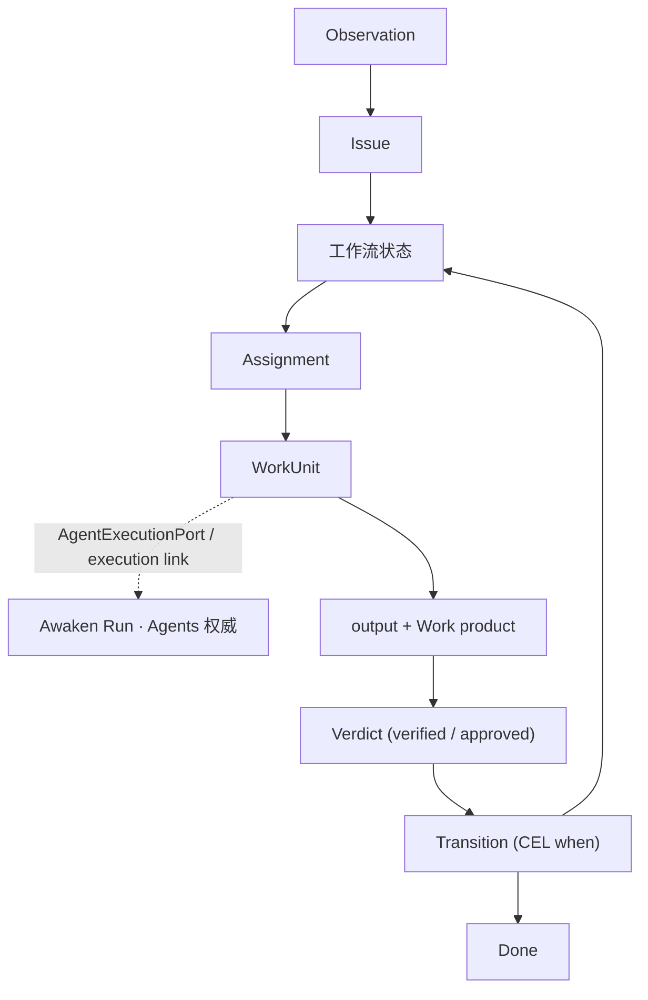

Awaken Workforce 的内核是**领域中立**的：它只认识一小组原语，对“营销”、“客户”或“程序员”一无所知。领域含义由[领域包](/zh/docs/workforce/concepts/domain-packs)添加。理解这少数几个核心对象，以及它们如何连接，是掌握其他一切的关键。如果你还没读过[作为运营契约的类型](/zh/docs/objects/concepts/type-system)，请先读它：本页是那个模型的具体化。

## 已提交状态、历史与实时检查

各领域保存自己的当前状态与解释变化所需的已提交事实。历史记录和投影不会替代这些状态：

- **当前状态**包括 Issue 的 Workflow 位置，以及 WorkUnit 的业务执行状态；由所属领域校验并持久化变化。
- **历史**记录已提交的转移和执行观察。Workforce 通过既有 inbox 与执行关联消费 Awaken lifecycle facts。
- **投影**从已提交状态和历史派生读取模型，不成为业务工作或技术执行的另一份权威。
- **实时检查**在相应执行边界验证当前 lease、credential 可用性与权限；旧观察不是当前授权。

[作为运营契约的类型](/zh/docs/objects/concepts/type-system#类型在哪里承载权威)列出当前契约实际验证的类型与检查。

## 内核对象

每个对象保留所属领域的权威。[核心对象指南](/zh/docs/workforce/concepts/core-concepts)维护完整工作模型；本页说明这些工作如何连接受治理的 Resource。

- **Actor** — 一个能提出 issue、做出反应或执行工作的身份（一个 User、Agent 或 Team）。
- **Resource** — 一个受治理的东西，issue 针对它被提出（一个仓库、一个连接器、一个工作产物、一个脚本、一种凭证种类——同一份目录，按 facet 定型）。
- **Issue** — 针对某个 resource 的、持久且可见的工作单元；主要的、由流程支撑的 **Subject**。
- **Reaction** — 系统对某个 issue 声明的响应；自动化的主干。
- **WorkUnit** — Workforce 中的一项业务执行责任；Agent-backed WorkUnit 关联 Awaken Run，不拥有另一套 Agent worker kernel。

Identity、authorization、admission、readiness、selection、approval 与实时执行检查分别回答不同问题。边界由[授权、就绪与资源](/zh/docs/objects/concepts/permissions-resources)说明。

### 流程层内部的带类型结构

工作流及其各部分**不是**顶层原语——它们是 Issue/流程层*内部*的带类型结构，赋予一个 Subject 其生命周期：

- **Workflow** — Work owner 的一等定义，以不可变 `WorkflowRevision` 发布；内部 `ProcessSpec` specification 表达 state、transition、slot、typed handoff 与 bounded iteration。Issue 创建时固定精确 revision。
- **State**（`ProcessState`）— 一个阶段，包含 slot、声明的 output export 与 required input，以及可选 fan-in 和 WIP limit。
- **Transition** — 状态之间一条带守卫的边；由一个 CEL `when` 谓词决定它是否触发（首个匹配者胜出）。
- **Agent** — Agent Actor 加 editable `AgentDef`（`role_prompt` 和可选 model handle）；executor 是 WorkUnit 的一个 *facet*，而非单独的根。
- **Tool** — 一项可调用的能力，调用时受审批门控。

### 资源是带操作的带类型对象（物模型）

**Resource** 根是“一个 agent 感知到一个面向对象的世界”变得
具体之处。一个 `ResourceType` 被声明为一个**物模型（thing model）**——一个带类型的形状加上
作用于它的操作：

- **属性（Properties）** — 带类型的 declared state、immutable-once/projected state、静态值、
  **计算 getter**，或持久 **Content**。Content 在 fact 中是封闭 descriptor，不可变 byte
  位于 content store 之后。
- **动作（Actions）** — 对象上带参数的方法。
- **事件（Events）** — 对象能发出什么（各带一个入站规范化脚本）；
  这些是 [reaction](/zh/docs/workforce/concepts/reactions) 的发出点。
- **生命周期（Lifecycle）** — 仅 host 的钩子（`verify`、`resolve`、`health`），由平台运行，
  绝不由 agent 运行。

只有**一份目录和一个名词，`Resource`**；一个类型由它的
**facet 区分，而非通过子类化**，并且只声明一种 governance kind：
`object`、`configuration`、`credential` 或 `connector`。Action 按名字对类型化实例派发。
跨对象 forwarding 通过类型化 requirement role 与 `via: role.action` 声明；Agent 只获得
显式授予的 read、mutation 与精确 Action，不存在 ambient generic invoke tool。
每个操作都在受治理、沙箱化、被检查 lease 的边界内运行（见
[开发一个领域包](/zh/docs/workforce/designing/develop-a-domain-pack)）。于是一个
agent 操作的是**拥有精确 Action 与计算属性的带类型领域对象**，而非一袋扁平的工具。

> **已交付。** 受治理的对象模型——类型、精确 Action、派发、计算属性与持久
> Content——已经过 owner API、Workflow、observation 与 realization 路径交付。
> Scope-console MCP endpoint 暴露五个固定操作：`resource.types`、`resource.query`、
> `resource.get`、`resource.realize` 与 `resource.changes`。Agent interaction 从精确 grant
> 派生更窄的 tool list，并可增加 relation、content read、terminal submission 或精确
> Action tool；它不会获得 ambient object-operation capability。

### 作用域树

每个对象都扎根于一棵所有权树：**Org ⊃ Workspace ⊃ Project**。一个 **Org** 是
租户边界；一个 **Workspace** 在其内部把工作分组；一个 **Project** 是
一个对象所属的最内层容器。一个单节点部署会播种一个单例的
Org，于是本地形态与托管形态是同一个模型。

## 工作与执行的权威

- **Assignment** 指定 Issue 的 Workflow state 中的责任槽位。
- **WorkUnit** 保存对应业务尝试、状态和已接受输出。
- **Awaken Run** 负责 Agent 技术执行、placement、await/resume 与终态事实。Agent-backed WorkUnit 通过 `AgentExecutionPort` 启动或重连它，并保存唯一精确执行关联。
- **Workflow 与 Issue** 决定已接受输出怎样推进工作，以及完成前需要满足哪些义务。Run 成功本身不是业务验收。

[Agent、WorkUnit 与 Awaken Run](/zh/docs/workforce/concepts/agents-runs)维护执行顺序、恢复与当前集成状态；[核心对象指南](/zh/docs/workforce/concepts/core-concepts)维护规划与人工义务对象。

## 身份与指派对象

谁可以被指派以及谁可以行动：

- **Workspace actor** — 跨越 **User**、**Agent** 或 **Team** 的通用指派身份。槽位解析为 workspace actor。
- **Team** — participation/selection 分组。Slot 当前选择具体 Actor 或通过 Team 解析；authorization 始终独立。
- **Principal** — 授权检查所用的带类型身份（`User`、`Agent`、`Team`、`ApiToken`、`System`）；规范的执行链是
  `[User(dispatcher), Agent(agent)]`。

> 角色授予的是**被指派的资格**，而非 API 能力。授权始终是一项独立的检查，见[权限与资源](/zh/docs/objects/concepts/permissions-resources)。

## 它们如何组合在一起

1. 一条入站**观察**（webhook、报告、计划任务）被去重，并作为一个绑定到某工作流的 **Issue** 落地。
2. 进入一个**状态**会从它的槽位创建出多个 **assignment**；每个都在分发门之后等待。
3. 已放行的 assignment 启动 **WorkUnit**。Agent-backed execution 通过既有执行 port 启动或重连 Awaken Run；lease 与 worker 由 Agents 管理。
4. 已提交 lifecycle facts 通过 inbox 返回同一个 WorkUnit；结构化输出仍须经过 Workflow 检查和人工决定。
5. **Transition** 读取声明的输出和 guard，不从自由文本猜测。
6. 完成条件与剩余义务得到满足后，Issue 才到达声明的终态。Agent 的终态结果本身不足以完成业务工作。

下一步：[工作流的各部分](/zh/docs/workforce/concepts/workflow-parts) ·
[Issues](/zh/docs/workforce/concepts/issues) ·
[Agents 与 runs](/zh/docs/workforce/concepts/agents-runs)。
